<picture>
  <source media="(prefers-color-scheme: dark)" srcset="./assets/hero-dark.svg">
  <source media="(prefers-color-scheme: light)" srcset="./assets/hero-light.svg">
  
</picture>

  <a href="https://github.com/DogerW666?tab=repositories"><b>REPOSITORIES</b></a>
  &nbsp;&nbsp;/&nbsp;&nbsp;
  <a href="mailto:wangdaoshuai.wds@alibaba-inc.com"><b>GET IN TOUCH</b></a>

 

I’m **Wang Daoshuai**, a **Shanghai Jiao Tong University alumnus** and software engineer working across **distributed data systems, cloud-native platforms, and AI infrastructure**. My experience includes **Alibaba** and **Bilibili**.

### 01 / Education

## Shanghai Jiao Tong University

**School of Electronic Information and Electrical Engineering** 
<samp>CLASS OF 2023</samp>

### 02 / Engineering stack

<table>
  <tr>
    <td width="50%" valign="top">
      <h3><a href="https://github.com/Eventual-Inc/Daft">Daft</a></h3>
      
<code>DATA ENGINE</code>

      
Data processing for AI and multimodal workloads.

    </td>
    <td width="50%" valign="top">
      <h3><a href="https://github.com/apache/spark">Apache Spark</a></h3>
      
<code>DISTRIBUTED ANALYTICS</code>

      
Large-scale data processing and distributed SQL.

    </td>
  </tr>
  <tr>
    <td width="50%" valign="top">
      <h3><a href="https://github.com/ray-project/ray">Ray</a></h3>
      
<code>DISTRIBUTED COMPUTE</code>

      
Distributed execution and infrastructure for AI.

    </td>
    <td width="50%" valign="top">
      <h3><a href="https://github.com/kubernetes/kubernetes">Kubernetes</a></h3>
      
<code>CLOUD-NATIVE INFRASTRUCTURE</code>

      
Container orchestration and cluster infrastructure.

    </td>
  </tr>
  <tr>
    <td colspan="2" valign="top">
      <h3>AI Infrastructure</h3>
      
<code>AI INFRA</code>

      
Infrastructure for AI workloads, connecting data processing, distributed compute, and cluster orchestration.

    </td>
  </tr>
</table>

### 03 / Experience

| Company | Role |
| :--- | :--- |
| **Alibaba** | **Senior Software Engineer** |
| **Bilibili** | **Software Engineer** |

### A little more about me

- **Languages I’ve worked with:** Python, Rust, Go, Java, Scala, C, C++, and C#.
- **Email:** [wangdaoshuai.wds@alibaba-inc.com](mailto:wangdaoshuai.wds@alibaba-inc.com) · [1150618528@qq.com](mailto:1150618528@qq.com)

 

---

<samp>Always maintain enthusiasm.</samp>

